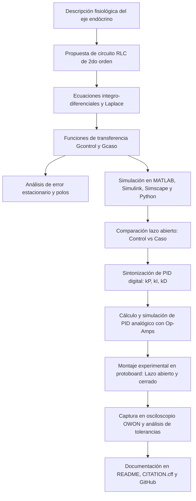

[](https://matlab.mathworks.com/open/github/v1?repo=Chander98MB/MSFP4) 

# Práctica 4 (5.6) — Modelo y control del sistema endócrino

Repositorio académico de la asignatura **Modelado de Sistemas Fisiológicos**, correspondiente al programa de **Ingeniería Biomédica** del Tecnológico Nacional de México / Instituto Tecnológico de Tijuana. Esta práctica integra el modelado fenomenológico simplificado de un eje endócrino mediante analogías eléctricas (circuito RLC de segundo orden), formulación matemática mediante ecuaciones integro-diferenciales y transformada de Laplace, análisis temporal, de error y de estabilidad, simulación computacional multifísica, diseño de un controlador PID ideal y analógico (mediante amplificadores operacionales), y validación experimental en el Laboratorio de Electrónica.

El caso de estudio representa los procesos de secreción, transporte, almacenamiento temporal y respuesta hormonal ante un estímulo sostenido en el sistema endocrino. Se busca reproducir y comparar la respuesta del nivel hormonal efectivo $V_s(t)$ ante una señal de entrada en la apertura o estímulo $V_e(t)$, evaluando tanto una condición de referencia o individuo sano (*control*) como una condición alterada (*caso*), implementando un lazo de control con retroalimentación negativa y un controlador PID (*tratamiento*) para corregir la dinámica patológica.

**Docente:** Dr. Paul Antonio Valle Trujillo  
**Correo:** paul.valle@tectijuana.edu.mx  
**Departamento:** Ingeniería Eléctrica y Electrónica  
**Institución:** Tecnológico Nacional de México / Instituto Tecnológico de Tijuana  
**Asignatura:** Modelado de Sistemas Fisiológicos  
**Programa:** Ingeniería Biomédica  
**Estudiante:** Zaid Alexander Arredondo Medina · 23212180 · L23212180@tectijuana.edu.mx

**Repositorio de la asignatura:** https://github.com/DrPaulValle/MSF-IBF1020  
**Sede:** Blvd. Alberto Limón Padilla s/n, Tijuana, C. P. 22454, B. C., México.

---

<a id="contenido"></a>
## Contenido

1. [Resumen](#resumen)
2. [Competencia y objetivos](#objetivos)
3. [Relación con el temario](#temario)
4. [Modelo físico y analogía eléctrica](#analogia)
5. [Formulación matemática](#modelo)
6. [Análisis temporal y de estabilidad](#analisis)
7. [Señales de entrada y condiciones de simulación](#senales)
8. [Implementación en MATLAB, Simulink y Simscape](#matlab)
9. [Control en lazo cerrado y sintonización PID](#pid)
10. [Reproducción en Python](#python)
11. [Controlador analógico y laboratorio](#laboratorio)
12. [Biorender](#biorender)
13. [Resultados y verificación cruzada](#resultados)
14. [Flujo de trabajo](#flujo)
15. [Actividades del estudiante](#actividades)
16. [Estructura del repositorio](#estructura)
17. [Requisitos](#requisitos)
18. [Reproducibilidad y entregables](#reproducibilidad)
19. [Referencias](#referencias)

---

<a id="resumen"></a>
## Resumen

La práctica tiene como propósito **reproducir un procedimiento completo de modelado, análisis, simulación, control y validación experimental** de un eje endócrino simplificado utilizando analogías de circuitos eléctricos. El sistema fisiológico se aproxima mediante un circuito RLC de segundo orden donde una resistencia $R_1$ representa el transporte, un capacitor $C$ la acumulación y almacenamiento temporal de hormona, una inductancia $L$ el retardo o inercia de la respuesta, y una resistencia $R_2$ la utilización o eliminación en el tejido diana. A partir de las leyes de Kirchhoff se obtiene un modelo integro-diferencial y su respectiva función de transferencia.

Se estudian el error en estado estacionario y la estabilidad del modelo analizando la localización de los polos en el plano complejo. Posteriormente se aplica una entrada de escalón unitario y se contrastan tres implementaciones computacionales en MATLAB, Simulink y Simscape Electrical. Se incorpora un **controlador PID con retroalimentación negativa**, cuyas ganancias se sintonizan mediante la herramienta *PID Tuner* y se traducen a componentes comerciales para su implementación física con amplificadores operacionales. Los resultados se reproducen de forma independiente mediante un script en Python y se contrastan con las mediciones físicas registradas en el Laboratorio de Electrónica.

Esta es una **práctica de reproducción y verificación**: se espera que el estudiante explique los resultados suministrados, identifique la correspondencia entre representaciones y distinga claramente cualquier aporte o modificación propia.

**Palabras clave:** circuito RLC de segundo orden; eje endócrino; controlador PID; amplificadores operacionales; MATLAB; Simulink; Simscape Electrical; Python; instrumentación electrónica.

[Volver al contenido](#contenido)

---

<a id="objetivos"></a>
## Competencia y objetivos

### Competencia a desarrollar

Modeliza sistemas fisiológicos mediante analogías eléctricas, ecuaciones diferenciales y funciones de transferencia para analizar su comportamiento dinámico y diseña estrategias de control mediante técnicas de control clásico. En particular, interpreta una descripción simplificada de los procesos de secreción, transporte, almacenamiento y respuesta hormonal para proponer un circuito eléctrico equivalente de segundo orden, compara una condición de referencia (*control*) con una condición alterada (*caso*), diseña un controlador PID y contrasta los resultados obtenidos mediante modelado analítico, simulación computacional y experimentación en el Laboratorio de Electrónica.

### Objetivo general

Reproducir, controlar y validar experimentalmente el modelo fenomenológico de segundo orden del sistema endócrino mediante su formulación matemática, implementación computacional en múltiples plataformas, diseño de controlador PID analógico y montaje físico en *protoboard*.

### Objetivos específicos

- Interpretar los procesos fisiológicos del eje endócrino para proponer la topología del circuito eléctrico equivalente de segundo orden.
- Establecer las correspondencias entre las variables hormonales y los elementos eléctricos (Ve(t), F_e(t), R1, C, L, R2, Fs(t), Vs(t)).
- Formular las ecuaciones integro-diferenciales mediante leyes de Kirchhoff y deducir la función de transferencia del sistema.
- Obtener de manera independiente las funciones de transferencia Gcontrol(s) y Gcaso(s) utilizando los valores comerciales especificados.
- Determinar analíticamente el error en estado estacionario ante una entrada escalón unitario y analizar la estabilidad mediante los polos de la planta.
- Simular el modelo en Simulink mediante ecuaciones integro-diferenciales, función de transferencia y componentes de Simscape Electrical.
- Comparar las respuestas temporales en lazo abierto entre el individuo sano (*control*) y la condición alterada (caso).
- Diseñar un sistema de control en lazo cerrado e implementar las ganancias del bloque PID sintonizadas con PID Tuner.
- Reproducir las respuestas de lazo abierto y lazo cerrado mediante MATLAB y Python bajo las mismas condiciones.
- Calcular los componentes comerciales (Re, Rr, Ce, Cr) requeridos para construir el controlador PID analógico con amplificadores operacionales.
- Construir y evaluar los circuitos equivalentes y el controlador analógico en el Laboratorio de Electrónica utilizando generador de funciones y osciloscopio.
- Documentar los resultados numéricos, gráficos y experimentales en un repositorio de GitHub.

[Volver al contenido](#contenido)

---

<a id="temario"></a>
## Relación con el temario

La práctica integra contenidos correspondientes a tres unidades de la asignatura **Modelado de Sistemas Fisiológicos (IBF-1020)**:

| Unidad | Área | Contenidos aplicados |
|---|---|---|
| I | Sistemas de control retroalimentados | Elementos del sistema de control, diagramas de bloques, señal de error, análisis de respuesta transitoria y estacionaria |
| II | Modelado matemático | Analogía eléctrica fenomenológica, ecuaciones integro-diferenciales, transformada de Laplace, polos y estabilidad en sistemas de segundo orden |
| III | Controladores | Sintonización de controladores PID y diseño de circuitos analógicos mediante amplificadores operacionales |

El enfoque combina **Ingeniería de Control, Electrónica Analógica, Ciencias de la Computación y Fisiología Endocrina**, de acuerdo con la competencia general de la asignatura.

[Volver al contenido](#contenido)

---

<a id="analogia"></a>
## Modelo físico y analogía eléctrica

El sistema endócrino se aproxima mediante un modelo fenomenológico de segundo orden. La topología del circuito equivalente presenta una rama principal con la fuente de voltaje Ve(t) y el resistor R1. En el nodo posterior a R1 se conecta un capacitor C hacia la referencia, en paralelo con una rama en serie constituida por el inductor L y el resistor R2. La salida Vs(t) se mide en el nodo de unión entre R1, C y L.

| Símbolo | Equivalente eléctrico | Interpretación fisiológica |
|---|---|---|
| Ve(t) | Voltaje de entrada | Estímulo para la secreción hormonal |
| Fe(t) | Corriente de entrada | Flujo de secreción y transporte hormonal |
| R1 | Resistencia | Pérdidas y oposición durante el transporte |
| C | Capacitancia | Acumulación temporal de hormona en el compartimento |
| L | Inductancia | Retardo o inercia de la respuesta del tejido diana |
| R2 | Resistencia | Utilización, disipación o eliminación de la señal hormonal |
| Fs(t) | Corriente de salida | Flujo asociado con la respuesta del órgano diana |
| Vs(t) | Voltaje de salida | Nivel hormonal efectivo y normalizado |

### Parámetros comerciales para la experimentación

| Componente | Control (Referencia) | Caso (Condición alterada) | Unidad eléctrica |
|---|---:|---:|---|
| R1 | 1 | 1 | kohms |
| L | 100 | 100 | mH |
| C | 1 | 1000 | mF |
| R2 | 100 | 1 | kohms |

La modificación simultánea de C y R2 altera drásticamente el amortiguamiento y la velocidad de respuesta del sistema entre ambas condiciones.

[Volver al contenido](#contenido)

---

<a id="modelo"></a>
## Formulación matemática

### 1. Ecuaciones integro-diferenciales

Aplicando las leyes de Kirchhoff en el nodo de salida y considerando las relaciones constitutivas de los elementos reactivos:


### 2. Función de transferencia

Aplicando la transformada de Laplace con condiciones iniciales nulas y resolviendo algebraicamente:


Sustituyendo los valores comerciales de cada condición:

* **Sistema Control:**


  
  

* **Sistema Caso:**


  
  

[Volver al contenido](#contenido)

---

<a id="analisis"></a>
## Análisis temporal y de estabilidad

### 1. Error en estado estacionario

Para una entrada de escalón unitario Ve(s) = 1/s, el valor final se evalúa mediante el teorema del valor final:


El error en estado estacionario $e_{ss} = 1 - G(0)$ resulta:

$$
\boxed{e_{ss} = \frac{R_1}{R_1 + R_2}}
$$

* **Condición Control:** $G_{\mathrm{control}}(0) = \frac{100}{101} \approx 0.9901\,\mathrm{V}$ ($e_{ss} \approx 0.99\%$).
* **Condición Caso:** $G_{\mathrm{caso}}(0) = \frac{1}{2} = 0.50\,\mathrm{V}$ ($e_{ss} = 50\%$).

### 2. Polos y estabilidad

Las raíces del polinomio característico determinan la ubicación de los polos:

* **Polos del Control:** $s_1 \approx -1000.99\,\mathrm{rad/s}$ y $s_2 \approx -1\,000\,000\,\mathrm{rad/s}$ (sistema estable y sobreamortiguado).
* **Polos del Caso:** $s_1 \approx -2.00\,\mathrm{rad/s}$ y $s_2 \approx -9999.00\,\mathrm{rad/s}$ (el polo dominante en $s_1 \approx -2\,\mathrm{rad/s}$ genera una respuesta lenta con $\tau \approx 0.5\,\mathrm{s}$).

Dado que $\text{Re}(s_{1,2}) < 0$, **ambos sistemas son estables en lazo abierto**.

[Volver al contenido](#contenido)

---

<a id="senales"></a>
## Señales de entrada y condiciones de simulación

El intervalo nominal de simulación es $0 \le t \le 10\,\mathrm{s}$ con un paso máximo de $\Delta t = 10^{-3}\,\mathrm{s}$ empleando el solver `ode15s`.

| Señal | Definición para la simulación | Propósito |
|---|---|---|
| Escalón unitario | $V_e(t) = u(t)$ | Examinar la respuesta transitoria y el nivel hormonal en estado estacionario |

[Volver al contenido](#contenido)

---

<a id="matlab"></a>
## Implementación en MATLAB, Simulink y Simscape

Se reproducen tres representaciones equivalentes del sistema en el cuaderno `Garcia23212195(P4).mlx` y el modelo `SistemaP4.slx`:
1. **Ecuaciones integro-diferenciales en Simulink:** Bloques de suma, ganancia e integración.
2. **Función de transferencia en Simulink:** Representación directa mediante bloques polinómicos.
3. **Circuito equivalente en Simscape Electrical:** Componentes pasivos discretos.

[Volver al contenido](#contenido)

---

<a id="pid"></a>
## Control en lazo cerrado y sintonización PID

### 1. Retroalimentación negativa

Se define la señal de error como $e(t) = V_{s,\mathrm{control}}(t) - V_{s,\mathrm{caso}}(t)$, incorporando el bloque **PID Controller** en Simulink.

### 2. Sintonización

Utilizando la herramienta *PID Tuner* (`Parámetros del controlador PID.png`), se obtienen las ganancias optimizadas:
* **Ganancia Proporcional ($k_P$):** $1672.0326$
* **Ganancia Integral ($k_I$):** $517\,743.8105$
* **Ganancia Derivativa ($k_D$):** $0.18001$
* **Coeficiente del filtro derivativo ($N$):** $6391.6622$

### 3. Realización analógica con amplificadores operacionales

Fijando $C_r = 1\,\mu\mathrm{F}$, los valores de diseño calculados (empleados en `Garcia23212195(P4).py`) son:
* $R_e = \frac{1}{C_r k_I} \approx 1.93\,\Omega$
* $R_r = k_P R_e \approx 3229.46\,\Omega$
* $C_e = \frac{k_D}{R_r} \approx 55.74\,\mu\mathrm{F}$

[Volver al contenido](#contenido)

---

<a id="python"></a>
## Reproducción en Python

El programa `Garcia23212195(P4).py`, ejecutado en **Visual Studio Code**, verifica de forma independiente la planta, el lazo cerrado con el PID y genera las respuestas forzadas en el intervalo de $10\,\mathrm{s}$, exportando la figura vectorial `SeñalEndocrino_Python.pdf`.

[Volver al contenido](#contenido)

---

<a id="laboratorio"></a>
## Controlador analógico y laboratorio

### Montaje y mediciones

1. **Lazo abierto:** Construcción de los circuitos *control* y *caso* en *protoboard*. Aplicación de onda de pulso para aproximar el escalón y registro simultáneo en osciloscopio digital **OWON** (`SeñalEndocrino_Laboratory.pdf`, escala vertical $500\,\mathrm{mV/div}$, base de tiempo $500\,\mathrm{ms/div}$).
2. **Lazo cerrado:** Integración del controlador PID analógico con fuente simétrica de $\pm 15\,\mathrm{V}$.
3. **Análisis de discrepancias:** Evaluación de tolerancias de componentes ($\pm 5\%$ en resistores, $\pm 20\%$ en capacitores), resistencia serie equivalente (ESR), saturación de op-amps y limitaciones de los instrumentos.

[Volver al contenido](#contenido)

---

<a id="biorender"></a>
## Biorender

Para contextualizar la analogía eléctrica del sistema endocrino con la fisiología real, se desarrolló un diagrama esquemático interactivo mediante BioRender. Este diagrama vincula cada compartimento y parámetro del circuito eléctrico equivalente con los procesos biológicos de secreción, transporte hormonal en sangre, retardo tisular y utilización en los órganos diana.


[Volver al contenido](#contenido)

---

<a id="resultados"></a>
## Resultados y verificación cruzada

Las simulaciones en MATLAB (`SeñalEndocrino_matlab.pdf`) y Python (`SeñalEndocrino_Python.pdf`) confirman que el sistema *control* estabiliza en $0.9901\,\mathrm{V}$ instantáneamente, mientras que el *caso* presenta un comportamiento exponencial lento que alcanza $0.50\,\mathrm{V}$. Al activar el controlador PID, la respuesta del paciente convergió con alta precisión hacia la referencia sana. La captura del osciloscopio OWON (`SeñalEndocrino_Laboratory.pdf`) valida experimentalmente estos resultados teóricos.

[Volver al contenido](#contenido)

---

<a id="flujo"></a>
## Flujo de trabajo



[Volver al contenido](#contenido)

---

<a id="actividades"></a>
## Actividades del estudiante

- [x] Interpretación fisiológica y propuesta de la topología del circuito equivalente.
- [x] Obtención de las funciones de transferencia $G_{\mathrm{control}}(s)$ y $G_{\mathrm{caso}}(s)$.
- [x] Cálculo analítico del error en estado estacionario y análisis de estabilidad mediante polos.
- [x] Implementación de los modelos en MATLAB/Simulink y Simscape Electrical.
- [x] Simulación comparativa en lazo abierto entre el individuo sano y la condición alterada.
- [x] Diseño y sintonización del controlador PID mediante *PID Tuner*.
- [x] Verificación cruzada independiente mediante Python en Visual Studio Code.
- [x] Cálculo y simulación del controlador PID analógico con amplificadores operacionales.
- [x] Validación experimental en el Laboratorio de Electrónica con osciloscopio OWON.
- [x] Elaboración del diagrama biológico en BioRender.
- [x] Estructuración y documentación formal del repositorio en GitHub.

[Volver al contenido](#contenido)

---

<a id="estructura"></a>
## Estructura del repositorio

```text
.
├── README.md                                                 # Reporte técnico y académico de la práctica
├── CITATION.cff                                              # Metadatos de citación del repositorio
├── Análisis matemático P4.pdf                                # Desarrollo analítico de la práctica
├── Diagrama de modelado y control del sistema endócrino.png  # Diagrama de modelado y control del sistema
├── Garcia23212195(P4).mlx                                    # Cuaderno computacional de MATLAB
├── Garcia23212195(P4).pdf                                    # Exportación en PDF del cuaderno MATLAB
├── Garcia23212195(P4).py                                     # Código fuente de reproducción en Python
├── SistemaP4.slx                                             # Modelos en Simulink y Simscape Electrical
├── SeñalEndocrino_matlab.pdf                                 # Gráfica vectorial generada en MATLAB
├── SeñalEndocrino_Python.pdf                                 # Gráfica vectorial generada en Python
├── Parámetros del controlador PID.png                        # Evidencia de sintonización en PID Tuner
├── SeñalEndocrino_Laboratory.pdf                             # Captura experimental del osciloscopio OWON
└── biorender_endocrino.png                                   # Diagrama biológico del sistema endocrino
```

[Volver al contenido](#contenido)

---

<a id="requisitos"></a>
## Requisitos

### Software
- **MATLAB y Simulink** (con *Control System Toolbox* y *Simscape Electrical*).
- **Python** (con bibliotecas `numpy`, `control`, `matplotlib`) ejecutado en **Visual Studio Code**.
- **Git y GitHub** para control de versiones.

### Laboratorio
- Fuente de alimentación simétrica, generador de funciones, osciloscopio digital OWON, protoboard, amplificadores operacionales y componentes pasivos comerciales.

[Volver al contenido](#contenido)

---

<a id="reproducibilidad"></a>
## Reproducibilidad y entregables

1. Clonar el repositorio y verificar los modelos en Simulink y MATLAB.
2. Ejecutar el cuaderno `.mlx` para generar las respuestas en lazo abierto y cerrado.
3. Ejecutar el script `Garcia23212195(P4).py` para validar la consistencia numérica en Python.
4. Revisar los registros del osciloscopio (`SeñalEndocrino_Laboratory.pdf`) y el diagrama de BioRender.

[Volver al contenido](#contenido)

---

<a id="referencias"></a>
## Referencias

[1] M. C. Khoo, *Physiological Control Systems: Analysis, Simulation, and Estimation*, 2nd ed., IEEE Press, 2018.  
[2] F. C. Hoppensteadt and C. S. Peskin, *Modeling and Simulation in Medicine and the Life Sciences*, Springer.  
[3] J. E. Hall, *Guyton and Hall Textbook of Medical Physiology*, 14th ed., Elsevier, 2021.  
[4] K. Ogata, *Ingeniería de Control Moderna*, 5.ª ed., Pearson Educación, 2010.  
[5] N. S. Nise, *Control Systems Engineering*, 8th ed., John Wiley & Sons, 2020.  
[6] P. A. Valle, *Syllabus para Modelado de Sistemas Fisiológicos*, Tecnológico Nacional de México / Instituto Tecnológico de Tijuana, Tijuana, B. C., México, 2026. Disponible en: https://biomath.xyz/course/  
[7] Tecnológico Nacional de México, *Programa de estudio de la asignatura Modelado de Sistemas Fisiológicos, IBF-1020*.

---

## Uso académico

Este repositorio se utiliza como evidencia formal de la **Práctica 4 (5.6): Modelado y control del sistema endócrino** de la carrera de Ingeniería Biomédica. Su contenido integra el análisis matemático, la simulación multifísica, el diseño electrónico analógico y la validación experimental en laboratorio.
